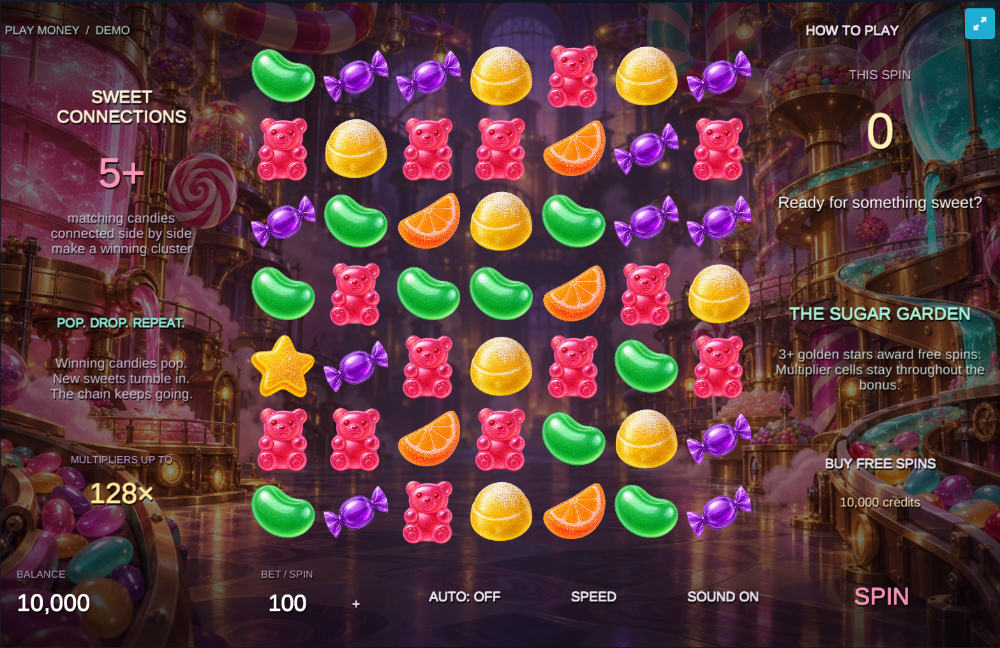
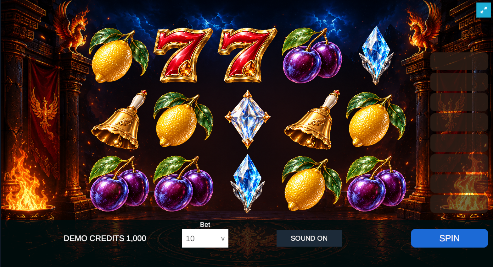
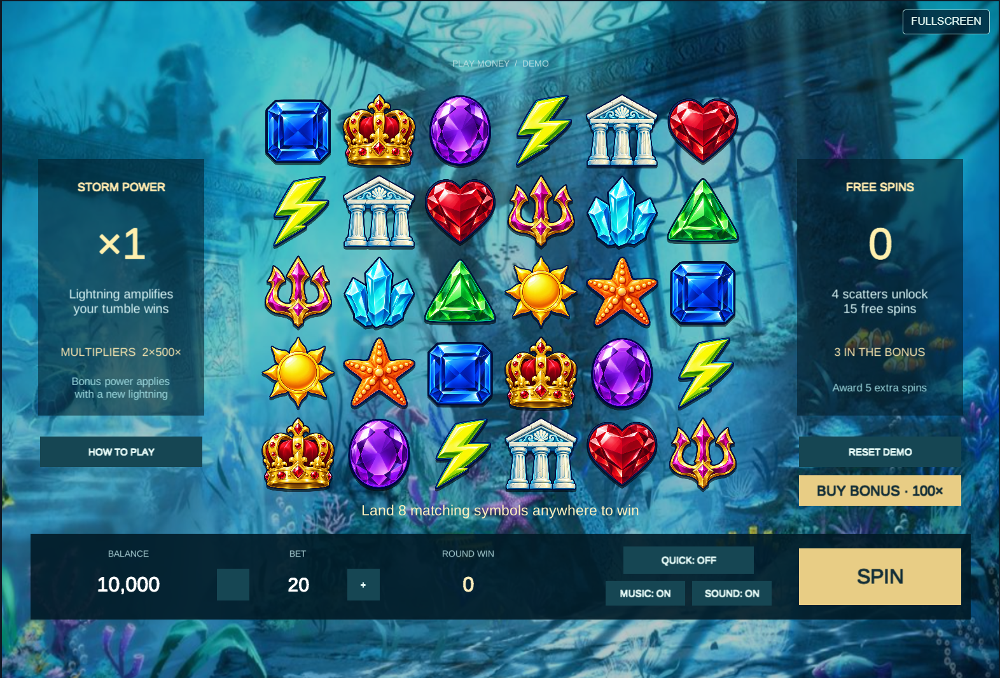

# CasinoSlots — Unity Slot Machine Projects

A collection of Unity slot-machine projects and themed demos, published for developers to explore, learn from, and extend.

**[Play the online demos](https://craiggriffiths.co.uk/casino-demo.html)** · **[Browse the source code](https://github.com/craiggriffiths2007/CasinoSlots)**

Built with **Unity 6 (6000.6.0f1)**.

## Screenshots

### Candy Cascade



### Firebird



### Tempest Temple



## Try the demos

You can try the available games in your browser on the **[Casino Demos page](https://craiggriffiths.co.uk/casino-demo.html)**.

## Projects in this repository

| Directory | Description |
| --- | --- |
| [CasinoSlots](CasinoSlots/) | Main Unity slot-machine project |
| [CandyCascade](CandyCascade/) | Candy-themed project |
| [CandyCascadeDemo](CandyCascadeDemo/) | Candy Cascade demo |
| [FirebirdDemo](FirebirdDemo/) | Firebird demo |
| [TempestTemple](TempestTemple/) | Tempest Temple-themed project |
| [TempestTempleDemo](TempestTempleDemo/) | Tempest Temple demo |

These are separate Unity project folders; open the one you want to explore rather than the repository root.

## Getting started

1. Install **Unity Hub** and **Unity Editor 6000.6.0f1**.
2. Clone the repository:
   ```bash
   git clone https://github.com/craiggriffiths2007/CasinoSlots.git
   ```
3. In Unity Hub, choose **Add project from disk**.
4. Select a project folder, for example `CasinoSlots/CasinoSlots` or `CasinoSlots/CandyCascade`.
5. Let Unity import the assets and packages.
6. Open a scene from the project's `Assets/Scenes` directory, where available, and press **Play**.

The repository contains source projects, not just playable builds. You can inspect the scenes, scripts, assets, and project settings directly in the Unity Editor.

## Development

Contributions, feedback, and suggestions are welcome. If you encounter a problem, please [open an issue](https://github.com/craiggriffiths2007/CasinoSlots/issues).

## License

This project is released under the **[MIT License](LICENSE)**. You are welcome to use, study, modify, and redistribute the code and original game artwork, including in commercial projects, subject to the license terms.

The game artwork, graphics, and visual assets created for this repository are original work. Unity and any separately licensed third-party packages remain subject to their respective terms.

---

**Created by [Craig Griffiths](https://craiggriffiths.co.uk/)** · [Play the demos](https://craiggriffiths.co.uk/casino-demo.html)
